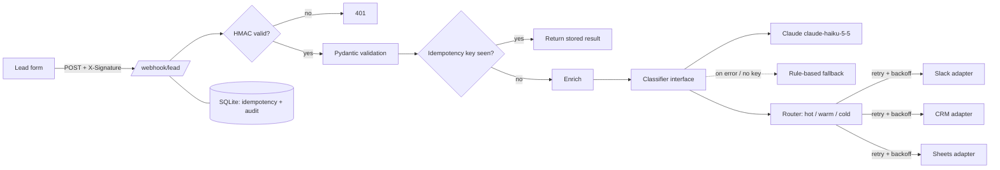

# n8n → FastAPI: lead router migration

> Your n8n / Make / Zapier flow got slow, expensive or brittle. I migrate it to a tested Python service you own.

This repo is a self-contained demo. `original_flow/` holds a typical no-code workflow. `app/` is the same flow rebuilt as a small FastAPI service, and `tests/` proves it behaves correctly. Everything runs offline, and all data is fake.

## The problem

The original flow (`original_flow/lead_router.n8n.json`) is a common pattern:

**Webhook (lead form) → enrich company → classify with an LLM → route** (hot → Slack + CRM, warm → CRM, cold → Google Sheet)

It works on day one. Then it runs into problems that are hard to see in a visual editor:

- **No signature check.** Anyone who finds the webhook URL can inject leads.
- **No dedupe.** Form providers retry, so the same lead creates two CRM deals and two Slack pings.
- **No retries.** One Slack or CRM timeout and the lead is gone without a trace.
- **LLM outage = data loss.** When the model times out, the whole execution fails.
- **No tests.** Every change is checked by hand in production.
- **Per-task pricing.** Each node counts as an operation, so costs grow with volume.

## Before / after

*Illustrative estimates for a 4-step flow at moderate volume. Real numbers depend on your plan, hosting and providers.*

| | No-code flow (before) | Python service (after) |
|---|---|---|
| Cost per 10k runs | ~$20–60 in task/operation fees, plus LLM | ~$1–5 of a small VM or container, plus LLM |
| Latency (p50, excluding LLM) | ~1–3 s (queueing + per-node overhead) | ~10–50 ms in-process |
| Duplicate handling | none | idempotency key + body hash, SQLite-backed |
| Failed outbound call | lead lost | exponential backoff; then 502 so the sender retries |
| LLM down | execution fails | falls back to deterministic rules |
| Testability | manual clicks | `pytest`, 11 tests, offline, under 2 s |
| Audit trail | execution log, limited retention | your own SQLite or Postgres table |
| Vendor lock-in | flow lives in the vendor's format | plain Python in your repo |

## Architecture



| Module | Responsibility |
|---|---|
| `app/main.py` | `POST /webhook/lead`, `GET /health`, orchestration |
| `app/security.py` | HMAC-SHA256 signature check (constant-time) |
| `app/store.py` | Idempotency claims and audit log (stdlib `sqlite3`) |
| `app/classifier.py` | `Classifier` interface: Claude via HTTP, rule fallback, `FallbackClassifier` |
| `app/sinks.py` | Pluggable outbound adapters and the routing table (same as the n8n Switch) |
| `app/retry.py` | Async retry with exponential backoff |
| `app/logging_setup.py` | JSON structured logs |

## Run it (2 commands)

```bash
pip install -r requirements.txt
uvicorn app.main:app --reload
```

Or with Docker: `docker build -t lead-router . && docker run -p 8000:8000 --env-file .env.example lead-router`

Send a signed test lead (the default secret is `change-me`):

```bash
BODY=$(cat original_flow/sample_lead.json)
SIG=$(printf '%s' "$BODY" | openssl dgst -sha256 -hmac change-me | awk '{print $2}')
curl -s localhost:8000/webhook/lead -H "Content-Type: application/json" \
  -H "X-Signature: sha256=$SIG" -H "Idempotency-Key: demo-1" -d "$BODY"
```

Set `ANTHROPIC_API_KEY` to classify with Claude. Without it, the service uses the rule-based classifier and makes no external calls.

Run the tests:

```bash
pytest -q
```

They cover a valid lead and its routing, a bad signature (401), an invalid payload (422), duplicates with and without a key, LLM-down fallback, sink retry recovery, and retry exhaustion (502, after which the same key can be retried).

## How I'd migrate YOUR flow

1. **Audit (1–2 days).** Export the flow JSON and a sample of recent executions. I map every node, credential, branch and implicit behavior: retries, error workflows, rate limits, and the data shapes each node really receives.
2. **Parity tests first.** Real past inputs (anonymized) become test fixtures, and the expected outputs come from what the current flow did. The new service has to match them before anything goes live.
3. **Build and shadow run.** The service runs alongside the existing flow and receives a copy of the traffic, with outbound sinks in dry-run mode. Any mismatch between the two shows up in a diff report.
4. **Cutover.** Point the webhook at the new service and keep the old flow disabled but intact so you can roll back in one click.
5. **Monitoring.** `/health` for uptime checks, structured logs, an audit table, and alerts on retry exhaustion and on LLM fallback rate.

You get the repo, the tests, a Dockerfile and a short runbook, with no lock-in to me or to a vendor.

## Fixed-price offers

| Tier | Scope | Price |
|---|---|---|
| Starter | One flow, up to ~5 nodes, 1 webhook in, up to 2 sinks, tests + Docker | from USD 500 |
| Standard | Up to ~15 nodes, LLM step, retries, idempotency, shadow run + cutover | from USD 1,200 |
| Pro | Multiple flows, queue/worker, Postgres, CI, monitoring + 30 days support | from USD 2,500 |

*Placeholder prices. Final quote after the audit.*

## Notes

- Enrichment is a local stand-in for the HTTP lookup node. Swap it for a real provider adapter.
- `ConsoleSink` and `StubSink` ship by default. Slack, Sheets and CRM adapters implement the same `send()` interface.
- SQLite fits a single instance. For multiple replicas, move the store to Postgres (same `claim` / `complete` contract).
